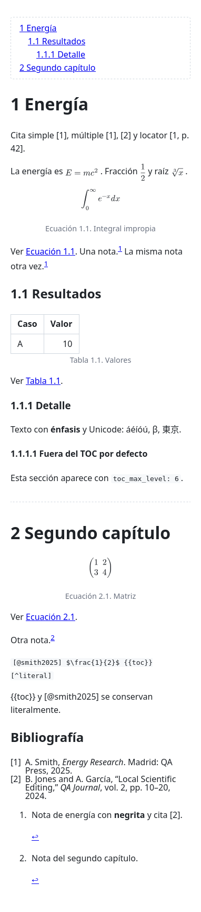

# Documento de demostración {#demo}

Ejemplo de trabajo con **todo el dialecto Markdown de minmark**. Cada sección
muestra el resultado y, justo debajo, el fuente entre comillas dentro de un
bloque de código. Puedes abrir este archivo en minmark y editarlo: es a la vez
una guía y un banco de pruebas.

{{toc}}

## Texto y énfasis {#texto}

**Negrita**, *cursiva*, ***negrita y cursiva***, ~~tachado~~, `código inline`
y un [enlace a la web](https://github.com/ximocm/minmark). También funcionan
los saltos de línea duros con dos espacios al final del renglón.

Para escribir la sintaxis de extensiones de forma literal se escapa el primer
carácter: `\{`, `\}`, `\:`, `\|` y `\\`.

```markdown
**Negrita**, *cursiva*, ***ambas***, ~~tachado~~, `código inline`
```

## Listas y tareas {#listas}

- Primera viñeta
  - Viñeta anidada
- Tercera viñeta

1. Primer paso
2. Segundo paso

- [ ] Tarea pendiente
- [x] Tarea completada

```markdown
- [ ] Tarea pendiente
- [x] Tarea completada
```

## Citas textuales y reglas {#citas-textuales}

> Un párrafo citado con **énfasis**.
>
> > Una cita anidada.

---

Una regla horizontal separa bloques.

## Tablas {#tablas}

Tablas GFM con alineación por columna. El bloque de atributos posterior añade
ID y pie numerado:

| Función | Sintaxis | Estado |
| :--- | :---: | ---: |
| Colores | `{danger: texto}` | Completo |
| Callouts | `::: note "Título"` | Completo |
| Ecuaciones | `$E=mc^2$` | Completo |

{#tbl:demo "Funciones del dialecto"}

Ver {{ref:tbl:demo}}. Dentro de una celda, una barra vertical se escribe `\|`.

```markdown
| Función | Sintaxis | Estado |
| :--- | :---: | ---: |
| Colores | `{danger: texto}` | Completo |

{#tbl:demo "Funciones del dialecto"}
```

## Enlaces e imágenes {#imagenes}

Enlaces relativos a otros documentos ([BUILDING](../BUILDING.md)), a una sección
de este documento ([Texto y énfasis](#texto)) y a la web. Un destino
inexistente muestra un subrayado ondulado y **Ctrl+Enter** explica el problema.

La imagen siguiente usa una captura incluida en el repositorio. El texto
alternativo es el pie de figura; `width` limita el ancho al porcentaje indicado.

{#fig:preview width=60%}

Ver {{ref:fig:preview}} (numeración derivada del documento, no escrita a mano).

```markdown
{#fig:preview width=60%}
```

## Colores inline {#colores}

`{nombre: texto}` pinta el texto; `{+nombre: texto}` pinta el fondo;
`{nombre+nombre: texto}` hace ambos. La paleta integrada tiene 9 colores
físicos y 8 semánticos:

| Físicos | Semánticos |
| :--- | :--- |
| red, orange, yellow | danger, warning, success |
| green, blue, purple | info, note, muted |
| gray, black, white | highlight, accent |

Texto de ejemplo: {danger: danger}, {warning: warning}, {success: success},
{info: info}, {note: note}, {muted: muted}, {accent: accent},
{red: red}, {green: green}, {purple: purple}. Con fondo:
{+highlight: highlight}, {danger+white: danger sobre blanco} y
{accent+highlight: accent sobre highlight}.

```markdown
{danger: texto rojo}
{+highlight: texto resaltado}
{accent+highlight: color y fondo}
```

Un proyecto puede añadir sus propios nombres con `custom_colors` en
`.mdproject.toml` (§58.2). Un nombre inexistente no falla: la construcción
entera queda como texto literal.

## Callouts {#callouts}

Bloques destacados `::: tipo "Título"`, cerrados con otra línea `:::` y
anidables. Tipos integrados: `note`, `info`, `tip`, `warning`, `danger` y
`success`.

::: warning "Advertencia"
Un callout puede contener **cualquier bloque**: listas, tablas, código…

1. Un elemento
2. Otro elemento
:::

::: tip "Anidado"
::: note "Interior"
Callouts anidados, uno dentro de otro.
:::
:::

```markdown
::: warning "Advertencia"
Contenido con **énfasis** y listas.
:::
```

Un proyecto puede declarar tipos propios con `custom_callout_types`.

## Matemáticas {#matematicas}

Matemáticas inline $E = mc^2$, fracción $\frac{1}{2}$, raíz $\sqrt[3]{x}$ y
griegas $\alpha + \beta = \gamma$. Bloque con ID y pie:

$$
\int_0^\infty e^{-x} \, dx = 1
$$
{#eq:integral "Integral impropia"}

Ver {{ref:eq:integral}}. El alcance es el subconjunto LaTeX del
[ADR-002](adr/002-latex-a-typst.md); una expresión no admitida muestra un
marcador en lugar de romper el documento.

```markdown
$E = mc^2$

$$
\int_0^\infty e^{-x} \, dx = 1
$$
{#eq:integral "Integral impropia"}
```

## Citas y bibliografía {#citas-y-bibliografía}

Cita simple [@smith2025], múltiple [@smith2025; @jones2024] y con localizador
[@jones2024, p. 12]. Localizadores admitidos: `p.`, `pp.`, `ch.`, `sec.`,
`fig.`, `tbl.` y `eq.`. Al escribir `[@` aparece el autocompletado sobre las
claves del `.bib`. La bibliografía de las citas citadas se añade al final del
documento con el estilo CSL configurado (IEEE por defecto).

```markdown
[@smith2025], [@smith2025; @jones2024], [@jones2024, p. 12]
```

La bibliografía de este documento sale de `qa/fixtures/references.bib` y
`qa/fixtures/extra.bib`, declarados en el front matter. Un archivo `.bib`
ausente o una clave desconocida se avisa sin dejar de editar.

## Notas al pie {#notas}

Una nota se cita con `Texto.[^etiqueta]` y se define con `[^etiqueta]: …`.[^ejemplo]
Las etiquetas repetidas comparten número.[^ejemplo]

```markdown
Texto.[^ejiqueta]

[^ejiqueta]: Contenido de la nota, con **énfasis** y citas [@smith2025].
```

## Referencias cruzadas y sustituciones {#sustituciones}

| Sustitución | Efecto |
| :--- | :--- |
| `{{toc}}` | Tabla de contenidos según `toc_max_level` |
| `{{pagebreak}}` | Salto de página en paginado y PDF |
| `{{ref:ID}}` | Referencia numerada a heading, figura, tabla o ecuación |

Los IDs se declaran con `{#id}` en headings, imágenes, tablas y ecuaciones;
los prefijos `fig:`, `tbl:` y `eq:` comparten la numeración con sus pies.
Un ID duplicado o una referencia sin destino muestra un aviso visible. En
código y con escapes, todo queda literal: `{{ref:sin-destino}}` es texto.

```markdown
{{toc}} · {{pagebreak}} · {{ref:fig:preview}}
```

Este documento contiene un salto de página real:

{{pagebreak}}

Todo lo que sigue empieza en página nueva en el Preview paginado y en el PDF.

Los **wiki links** `[[nombre]]` y `[[nombre#heading]]` están desactivados por
defecto y se habilitan con `wiki_links = true` en `.mdproject.toml` o en la
configuración global.

## Código {#codigo}

```rust
fn main() {
    // Dentro del código, las extensiones son literales:
    // {danger: esto no es un color} ni [@smith2025] una cita.
    println!("Hola, minmark");
}
```

## Front matter {#front-matter}

El bloque YAML inicial configura el documento. Claves admitidas:

| Clave | Efecto | Ejemplo |
| :--- | :--- | :--- |
| `bibliography` | Ruta o lista de `.bib` | `qa/fixtures/references.bib` |
| `bibliography_style` | Archivo CSL independiente | `estilo.csl` |
| `heading_numbering` | Numera headings | `true` |
| `counter_numbering` | Contadores continuos o por capítulo | `by_chapter` |
| `toc_max_level` | Profundidad de `{{toc}}` (1–6) | `3` |
| `language` | Etiquetas de figuras/tablas/ecuaciones | `es` |
| `pagination` | Preview paginado | `false` |

```yaml
---
bibliography: [qa/fixtures/references.bib, qa/fixtures/extra.bib]
heading_numbering: true
counter_numbering: by_chapter
toc_max_level: 3
language: es
---
```

[^ejemplo]: Nota de demostración con **negrita** y una cita [@jones2024].
