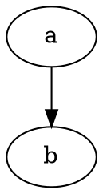

# Custom Markdown Desktop App — Especificación de Producto y Software

**Versión:** 1.1  
**Estado:** Consolidada  
**Cambios 1.1:** gramática formal de extensiones y escaping (§7.4); sintaxis de colores con `:` (§23).  
**Plataforma inicial:** Linux  
**Segunda plataforma:** Windows  
**Lenguaje obligatorio del core:** Rust  
**Prioridad 1:** Velocidad  
**Prioridad 2:** Estética  
**Modelo:** Local-first, offline-first, sin nube y sin telemetría

---

# 1. Propósito

La aplicación será un editor de Markdown de escritorio ultrarrápido, minimalista y local-first orientado tanto a archivos individuales como a proyectos documentales compuestos por múltiples archivos Markdown.

La aplicación deberá combinar:

- edición Markdown tradicional;
- edición visual directa sobre el mismo documento Markdown;
- apertura de archivos y carpetas;
- exploración de proyectos;
- enlaces internos entre archivos;
- composición de documentos a partir de múltiples `.md`;
- ecuaciones;
- bibliografía y citas;
- referencias cruzadas;
- tablas de contenidos;
- Preview continuo y paginado;
- exportación PDF mediante Typst;
- recuperación automática de trabajo no guardado;
- una interfaz extremadamente limpia.

La aplicación **no será un IDE generalista**, una suite ofimática, un servicio cloud ni una plataforma colaborativa.

---

# 2. Principios normativos

Los términos **DEBE**, **NO DEBE**, **DEBERÁ** y **NO DEBERÁ** son requisitos obligatorios.

Los términos **PUEDE** y **PODRÁ** indican comportamiento opcional o previsto para una fase posterior.

En caso de conflicto entre requisitos, el orden de prioridad será:

1. Integridad y control de los archivos del usuario.
2. Privacidad y funcionamiento local.
3. Velocidad y capacidad de respuesta.
4. Preservación del Markdown.
5. Compatibilidad y portabilidad.
6. Estética.
7. Funcionalidades secundarias.

---

# 3. Privacy & Control Promise

Esta sección es un compromiso permanente del producto.

## 3.1 Tus archivos son tuyos

La aplicación **NO DEBE** apropiarse del contenido del usuario, convertirlo a un formato propietario obligatorio ni requerir una cuenta.

Los documentos seguirán siendo archivos normales que el usuario puede abrir con cualquier editor compatible:

- `.md`
- `.bib`
- `.csl`
- `.toml`
- imágenes y recursos estándar

El proyecto será una carpeta normal del sistema de archivos.

## 3.2 Nunca nube

La aplicación **NO DEBE implementar almacenamiento cloud, sincronización cloud, backup cloud, cuentas online ni workspaces remotos**, ni siquiera como requisito opcional para utilizar funcionalidades principales.

No existirán:

- documentos alojados por el proveedor;
- sincronización automática;
- backups remotos;
- perfiles cloud;
- inicio de sesión obligatorio;
- sincronización de preferencias mediante servidores propios.

La aplicación deberá funcionar completamente sin conexión a Internet.

## 3.3 Nunca telemetría

La aplicación **NO DEBE incluir telemetría**.

Esto incluye expresamente:

- analytics;
- métricas de uso;
- tracking;
- identificadores de dispositivo;
- fingerprinting;
- estadísticas anónimas;
- crash reports automáticos;
- SDK de telemetría;
- remote feature flags;
- experimentos A/B controlados remotamente.

Los logs de diagnóstico serán exclusivamente locales.

El usuario podrá exportar manualmente logs para adjuntarlos a un informe de error.

## 3.4 Nunca tráfico de red automático

El core de la aplicación **NO DEBE necesitar red** para editar, renderizar, buscar, indexar, componer, citar ni exportar.

La aplicación no realizará conexiones de red en segundo plano.

Los enlaces HTTP/HTTPS contenidos en un documento podrán abrirse mediante una acción explícita del usuario y deberán delegarse al navegador del sistema.

No habrá actualizador interno en la primera versión.

## 3.5 Nunca lock-in

El usuario deberá poder abandonar la aplicación y conservar:

- sus `.md`;
- su estructura de carpetas;
- sus imágenes;
- sus `.bib`;
- sus `.csl`;
- su configuración textual de proyecto.

La configuración específica del proyecto utilizará `.mdproject.toml`, un formato textual legible.

## 3.6 Nunca escrituras silenciosas en documentos reales

La aplicación **NO DEBE guardar automáticamente el `.md` real**.

El archivo original se modifica únicamente mediante una acción explícita de guardado.

La recuperación automática utilizará snapshots internos separados del archivo original.

## 3.7 Control del usuario

La aplicación deberá priorizar acciones explícitas, reversibles y observables.

No deberá:

- borrar archivos permanentemente mediante la acción normal de Delete;
- sobrescribir archivos externos silenciosamente;
- recargar cambios externos sin consentimiento;
- modificar Markdown solo por cambiar entre modos de edición;
- borrar snapshots automáticamente por antigüedad;
- modificar una carpeta únicamente por abrirla como proyecto.

---

# 4. Lean Dependency Promise

El número de dependencias deberá mantenerse deliberadamente al mínimo.

## 4.1 Standard library first

Antes de añadir una dependencia de producción deberá evaluarse si la funcionalidad puede implementarse de forma razonable con:

- Rust `std`;
- APIs del sistema operativo;
- componentes ya presentes en el proyecto.

No se añadirá una dependencia externa para utilidades triviales si su funcionalidad puede implementarse de manera pequeña, segura y mantenible internamente.

## 4.2 Una responsabilidad, una solución

La aplicación **NO DEBE mantener múltiples dependencias de producción que resuelvan sustancialmente el mismo problema**.

Ejemplos:

- un único parser principal de Markdown;
- un único sistema de serialización de configuración;
- un único motor PDF;
- un único mecanismo de filesystem watching por plataforma/abstracción;
- un único toolkit de UI seleccionado para producción.

## 4.3 Dependencias estratégicas

Una dependencia grande solo será aceptable si sustituye varias dependencias menores o resuelve una funcionalidad crítica difícil de implementar correctamente.

Typst queda aceptado como dependencia estratégica porque será el único motor de composición y PDF y cubrirá layout, paginación, tipografía, matemáticas y salida PDF.

## 4.4 Revisión obligatoria

Toda nueva dependencia de producción deberá justificar:

- qué problema resuelve;
- por qué no se utiliza `std`;
- número aproximado de dependencias transitivas;
- impacto en tamaño de binario;
- impacto en tiempo de compilación;
- impacto en startup;
- licencia;
- mantenimiento;
- seguridad;
- compatibilidad Linux/Windows.

Los aumentos relevantes del árbol de dependencias deberán documentarse mediante una decisión arquitectónica.

## 4.5 Features mínimas

Cuando una crate permita desactivar features por defecto, se habilitarán únicamente las necesarias.

## 4.6 Dependencias de desarrollo

Las dependencias utilizadas exclusivamente para tests, benchmarks, linting o empaquetado no cuentan como dependencia de runtime, pero también deberán mantenerse razonables.

## 4.7 Electron prohibido

Electron queda expresamente descartado.

Si la UI seleccionada utiliza tecnologías web, deberá utilizar una WebView ligera y preferentemente el motor disponible en el sistema, sin distribuir un Chromium completo.

---

# 5. Arquitectura tecnológica

## 5.1 Core

El core deberá estar implementado en **Rust**.

Rust gestionará como mínimo:

- buffers de documentos;
- lectura y escritura;
- proyectos;
- configuración;
- parser y modelo documental;
- composición;
- enlaces;
- referencias;
- bibliografía;
- búsqueda;
- indexado;
- filesystem watching;
- snapshots;
- pipeline de exportación;
- comunicación con el motor PDF.

## 5.2 Tecnología de interfaz

La tecnología final de UI **NO queda predeterminada**.

Antes de seleccionarla deberán implementarse microprototipos comparativos de:

1. una solución ligera basada en WebView;
2. una solución Rust-native.

La selección se basará en mediciones reproducibles de:

- startup;
- RAM;
- latencia de escritura;
- rendimiento con archivos grandes;
- velocidad Markdown ↔ Visual;
- calidad y complejidad del modo Visual;
- accesibilidad;
- comportamiento Linux;
- comportamiento Windows;
- número y peso de dependencias.

La tecnología elegida deberá respetar el Lean Dependency Promise.

## 5.3 Motor PDF

Typst será el **único motor de generación PDF** en la primera versión.

Pipeline normativo:

```text
Markdown
   ↓
Modelo documental / AST
   ↓
Composición
   ↓
Citas, referencias y matemáticas
   ↓
Representación Typst
   ↓
Typst
   ↓
PDF
```

El usuario no necesitará escribir Typst.

---

# 6. Modelo documental

## 6.1 Fuente de verdad

El `.md` es la fuente de verdad.

No existirán dos versiones independientes del documento para Markdown y Visual.

Arquitectura conceptual:

```text
                   archivo .md
                       │
                       ↓
             buffer Markdown único
                       │
                       ↓
             modelo sintáctico / AST
                 ↙             ↘
                ↓               ↓
      Editor Markdown      Editor Visual
                │               │
                └──────┬────────┘
                       ↓
                    guardado
                       ↓
                   archivo .md
```

## 6.2 Fidelidad

Cambiar entre modos de edición **NO DEBE reformatear innecesariamente el Markdown**.

La aplicación deberá preservar, siempre que la edición realizada no obligue a cambiarlo:

- espacios;
- líneas en blanco;
- estilo de marcador de énfasis;
- enlaces;
- listas;
- fences de código;
- estructura general;
- saltos de línea LF/CRLF.

---

# 7. Dialecto Markdown

## 7.1 Base

La base será:

- CommonMark;
- GitHub Flavored Markdown (GFM).

Sobre ella se añadirán extensiones documentadas por esta aplicación.

## 7.2 HTML

HTML embebido **NO se interpretará**.

Si un archivo contiene HTML, se tratará como texto Markdown y nunca ejecutará JavaScript ni contenido activo.

## 7.3 Extensiones propias

La aplicación soportará adicionalmente:

- bloques `:::`;
- colores semánticos;
- ecuaciones LaTeX;
- citas Pandoc;
- referencias cruzadas;
- tabla de contenidos;
- saltos de página;
- atributos controlados de imágenes;
- wiki links opcionales;
- diagramas DOT.

### 7.3.1 Diagramas DOT

Sintaxis: bloque cercado con info `dot` (Graphviz):

````md

````

Preview y PDF renderizan el MISMO diagrama (paridad obligatoria). El fuente
Markdown sigue siendo el bloque de código (§6.1): nunca se sustituye ni se
normaliza.

DOT inválido no silencia ni deforma nada (ADR-002): se muestra el marcador
visible `⚠ [diagrama no válido: …]` en Preview y PDF y el bloque de código
permanece visible y editable (§8.4). Lo que el motor no soporta sin
deformar (clusters, atributos y valores fuera del subconjunto de ADR-007)
produce el mismo marcador.

El render es 100% local: sin red, sin binarios externos y sin motor de
JavaScript. Los glifos se dibujan con las fuentes empaquetadas del producto
(tipografía idéntica en Preview y PDF).

## 7.4 Gramática de extensiones y escaping

Esta subsección es normativa y desambigua todas las extensiones propias.

### 7.4.1 Principios

- **Vocabulario cerrado**: solo las construcciones definidas aquí son sintaxis.
  Todo lo demás es texto literal y se preserva tal cual (§6.2).
- **Posición**: los atributos solo se reconocen en posición de atributo (§7.4.3).
- **Código primero**: dentro de code spans y fences no se interpreta ninguna
  extensión.

### 7.4.2 Sustituciones

Forma: `{{nombre}}` o `{{ref:ID}}`, con `ID` formado por `[A-Za-z0-9:._-]+`.

Vocabulario cerrado:

- `{{toc}}` (§29);
- `{{pagebreak}}` (§31);
- `{{ref:ID}}` (§26.5).

Cualquier otra secuencia `{{...}}` es texto literal.

### 7.4.3 Atributos

Forma:

```text
{#id "caption" clave=valor ...}
```

- `#id` opcional: `[A-Za-z0-9:._-]+` tras `#`;
- `caption` opcional: cadena entrecomillada;
- pares `clave=valor` opcionales. Único valor con significado en v1: `width=N%`
  (1–100) (§18.5).

Posiciones de atributo, las únicas reconocidas:

1. inmediatamente después de una imagen inline: ` {…}` (§18.5);
2. en una línea propia, inmediatamente después de una tabla (§26.3) o de una
   ecuación de bloque (§26.4);
3. inmediatamente después de un heading: `## Título {#id}` (§26.1).

En cualquier otra posición, `{…}` es texto literal.

Compatibilidad declarada: la forma es compatible con los atributos de
Pandoc/GFM. Las diferencias son el caption entrecomillado y `width` solo
expresado en `%`. No se garantiza compatibilidad con el resto del modelo de
atributos de Pandoc.

### 7.4.4 Colores inline

Forma: `{'+'? nombre ('+' nombre)?: texto}`, p. ej. `{danger: x}`,
`{+highlight: x}`, `{accent+highlight: x}` (§23), con `nombre` =
`[A-Za-z][A-Za-z0-9_-]*`.

Solo en texto inline; nunca es una línea de atributo. Un nombre inexistente en
las paletas y en `.mdproject.toml` hace que toda la construcción sea texto
literal.

### 7.4.5 Variables de plantilla

`{title}`, `{author}`, `{project}`, `{chapter}`, `{page}`, `{pages}`, `{date}`
(§32.9) solo se interpretan dentro de plantillas de header/footer. En el cuerpo
del documento son texto literal.

### 7.4.6 Escaping

Basado en el escaping de CommonMark: `\{`, `\}`, `\:`, `\|` y `\\` producen el
carácter literal. Una `{` precedida de `\` nunca inicia sintaxis extendida.

| Escrito | Resultado |
|---|---|
| `{{toc}}` | tabla de contenidos |
| `{{foo}}` | `{{foo}}` literal |
| `\{{toc}}` | `{{toc}}` literal |
| `\{danger: x}` | `{danger: x}` literal |

### 7.4.7 Precedencia

De mayor a menor:

1. code spans y fences;
2. escapes `\`;
3. sustituciones `{{...}}`;
4. atributos en posición de atributo;
5. colores inline;
6. variables de plantilla en headers/footers.

Cuando una cadena encaja en varias producciones, gana la de mayor precedencia y
el resto se analiza como texto literal.

---

# 8. Modos de edición

Existirán exactamente dos modos de escritura:

1. **Markdown**
2. **Visual**

El switch será visible y compacto:

```text
Markdown | Visual
```

Atajo por defecto:

```text
Ctrl+Alt+M
```

El atajo será reasignable.

## 8.1 Markdown

Muestra la sintaxis directamente:

```md
## Instalación

Texto en **negrita**.
```

## 8.2 Visual

Representa la misma fuente Markdown mediante elementos semánticos editables:

```text
Instalación     ← H2

Texto en negrita.
```

## 8.3 Visibilidad de sintaxis en Visual

Será configurable:

- ocultar siempre la sintaxis;
- revelar temporalmente la sintaxis del elemento actualmente editado.

## 8.4 Sintaxis no soportada

Cualquier construcción que el editor Visual no pueda representar con seguridad deberá aparecer como un **bloque Markdown editable**.

La aplicación no intentará reinterpretarla ni eliminarla.

## 8.5 Undo/Redo

Markdown y Visual compartirán un único historial.

Cambiar de modo no reinicia Undo/Redo.

## 8.6 Cursor y selección

Al cambiar de modo deberá conservarse:

- posición semántica del cursor;
- selección semántica equivalente.

---

# 9. Modos de vista

La forma de editar y la forma de visualizar son conceptos independientes.

Existirán:

- **Editor**
- **Split**
- **Preview**

## 9.1 Split

Editor y Preview se mostrarán simultáneamente.

El scroll estará sincronizado bidireccionalmente mediante posición semántica, no mediante porcentaje bruto de desplazamiento.

Doble clic en un elemento del Preview deberá mover el cursor al elemento equivalente del editor.

---

# 10. Continuous y Pages

## 10.1 Editor

El editor será **siempre continuo**, tanto en Markdown como Visual.

Nunca se escribirá directamente sobre páginas simuladas.

## 10.2 Preview continuo

El Preview continuo no tendrá límites de página.

Ancho máximo por defecto:

```text
800 px
```

Será configurable.

## 10.3 Preview paginado

La paginación solo existirá en:

- Preview/Page Mode;
- PDF.

La paginación será configurable en documento, composición, proyecto y global (§58).

## 10.4 Dark Mode

En tema oscuro, las páginas del Preview paginado serán oscuras.

Esto es solo una representación de pantalla.

Los PDF serán siempre de fondo blanco y texto oscuro.

---

# 11. Temas

Temas disponibles:

- Light;
- Dark;
- System.

Valor inicial:

```text
System
```

El Preview continuo seguirá el tema de la aplicación por defecto, pero este comportamiento será configurable.

---

# 12. Archivos

## 12.1 Crear

`Ctrl+N` crea un nuevo documento Markdown.

## 12.2 Abrir

La aplicación abrirá:

- `.md`;
- `.markdown`.

## 12.3 Guardar

`Ctrl+S` guarda explícitamente el archivo.

No existe autosave del archivo real.

## 12.4 Guardar como

`Ctrl+Shift+S` ejecuta Save As.

## 12.5 Codificación

Solo se admite UTF-8.

Un archivo que no pueda interpretarse como UTF-8 deberá producir un error claro.

No se realizarán conversiones silenciosas.

## 12.6 Saltos de línea

Se preservará el formato original:

- LF permanece LF;
- CRLF permanece CRLF.

Los archivos nuevos utilizarán LF.

## 12.7 Cambios externos

Si un archivo abierto cambia externamente:

- se notificará;
- nunca se recargará automáticamente;
- nunca se sobrescribirá silenciosamente.

Si otro programa elimina o mueve el archivo:

- el contenido seguirá abierto en memoria;
- se notificará;
- el usuario podrá Save, Save As o cerrar.

---

# 13. Recuperación y cierre

## 13.1 Snapshots

La aplicación mantendrá snapshots internos de recuperación.

Los snapshots:

- no modifican el archivo real;
- permiten recuperar cierres inesperados;
- permiten conservar cambios de pestañas cerradas.

## 13.2 Cierre de aplicación

Cerrar la aplicación no mostrará un diálogo de guardado.

Los cambios no guardados se conservarán en snapshots y se restaurarán con la sesión.

## 13.3 Cierre de pestaña

`Ctrl+W` cerrará una pestaña sin preguntar.

Una pestaña cerrada deliberadamente:

- no se restaurará automáticamente al reiniciar;
- quedará en `Recently Closed`;
- podrá recuperarse con `Ctrl+Shift+T`.

## 13.4 Retención

Los snapshots no caducarán automáticamente.

Solo se eliminarán manualmente (§13.6).

## 13.5 Límite

Límite por defecto:

```text
1 GB
```

Será configurable (§58.2).

Al alcanzarlo (§13.6):

- la aplicación dejará de crear snapshots nuevos;
- mostrará un aviso persistente hasta que el usuario resuelva la situación;
- los snapshots existentes permanecen intactos;
- el guardado real (`Ctrl+S`) sigue disponible sin restricciones;
- el usuario puede seguir editando normalmente.

## 13.6 Gestión de snapshots

Cuando el almacenamiento alcanza el límite (§13.5):

1. **Detener creación**: la aplicación no crea más snapshots automáticos.
2. **Aviso persistente**: indicador visible en la UI (barra de estado o similar)
   hasta que el usuario resuelva (subir límite o borrar snapshots manualmente).
3. **Edición y guardado continúan**: el usuario puede seguir escribiendo y
   guardando con `Ctrl+S` normalmente; solo falta la red de seguridad de
   snapshots hasta resolver.
4. **Resolución manual**: el usuario puede:
   - subir el límite de almacenamiento (configuración);
   - eliminar uno o más snapshots manualmente (§13.7);
   - vaciar todos los snapshots (reset completo).

No se pierden datos silenciosamente (NFR-026): los cambios no guardados en el
archivo real solo se conservan si el usuario guarda explícitamente o si hay
snapshots disponibles (debajo del límite).

## 13.7 Eliminación manual de snapshots

La aplicación proporcionará una vista de gestión de snapshots donde el usuario
podrá:

- ver todos los snapshots con timestamp, documento asociado y tamaño;
- seleccionar uno o varios snapshots;
- eliminar los seleccionados;
- vaciar todos los snapshots (reset completo).

La eliminación es permanente (no usa la papelera del sistema, §14.9 aplica a
archivos/carpetas del proyecto, no a snapshots internos).

---

# 14. Proyecto

## 14.1 Open Folder

Abrir una carpeta la convierte en proyecto.

Un proyecto tendrá exactamente **una carpeta raíz por ventana**.

No habrá multi-root workspace inicialmente.

## 14.2 No modificación al abrir

Abrir una carpeta no deberá crear ni modificar archivos.

`.mdproject.toml` se creará únicamente cuando una funcionalidad necesite persistir configuración de proyecto.

Configuración en cinco niveles, de mayor a menor prioridad (§58):

1. documento (YAML front matter);
2. composición (`[[composition]]` en `.mdproject.toml`);
3. proyecto (`.mdproject.toml`);
4. global (configuración de la aplicación);
5. defecto (valores normativos de la SRS, ver §58.2).

Si un nivel declara una clave inexistente o fuera de su ámbito, se ignora **con
aviso no bloqueante** una vez por documento/proyecto (no es pérdida silenciosa
NFR-026).

## 14.3 Explorador

Habrá un panel lateral de archivos:

- ocultable;
- sin Activity Bar;
- sin sidebar multipropósito;
- ancho redimensionable;
- estado restaurable.

Atajo:

```text
Ctrl+B
```

## 14.4 Tipos visibles por defecto

El explorador mostrará por defecto archivos relevantes para documentación:

- Markdown;
- imágenes;
- `.bib`;
- `.csl`;
- `.toml`;
- recursos documentales reconocidos.

Existirá `Show All Files`, activable desde el menú **View** (no dentro del
panel del explorador, que debe poder estrecharse libremente).

## 14.5 Hidden files

Los archivos ocultos estarán ocultos por defecto.

Existirá `Show Hidden Files`, activable desde el menú **View**.

## 14.6 `.gitignore`

Los archivos ignorados por `.gitignore` seguirán visibles en el explorador, pero se excluirán por defecto de:

- búsqueda global;
- indexado;
- análisis de enlaces;
- backlinks;
- autocompletado.

## 14.7 Symlinks

Se mostrarán symlinks.

Las carpetas enlazadas mediante symlink no se recorrerán recursivamente.

## 14.8 Crear y gestionar

El explorador permitirá:

- crear Markdown;
- crear carpeta;
- renombrar;
- mover;
- duplicar;
- eliminar;
- copiar ruta relativa.

Click derecho deberá incluir `Rename`.

## 14.9 Delete

La acción normal Delete enviará archivos y carpetas a la papelera del sistema.

No será un borrado permanente.

---

# 15. Archivos externos e importación

Un `.md` externo al proyecto podrá abrirse en una pestaña.

Mientras siga fuera:

- no pertenece al proyecto;
- no aparece en el árbol;
- no entra en indexado del proyecto;
- no entra en composiciones.

Para incorporarlo deberá utilizarse:

```text
Import Markdown
```

Importar:

- copia el archivo;
- no mueve ni modifica el original;
- solicita carpeta destino dentro del proyecto;
- nunca sobrescribe silenciosamente.

---

# 16. Renombrado y movimiento inteligente

Renombrar o mover un archivo/carpeta dentro del proyecto deberá actualizar automáticamente las referencias afectadas:

- enlaces Markdown;
- wiki links activos;
- imágenes;
- rutas `.bib`;
- rutas `.csl`;
- composiciones;
- `.mdproject.toml`.

Si la aplicación no puede garantizar la actualización segura de todas las referencias conocidas afectadas, la operación de renombrado o movimiento deberá abortarse y mostrar un error. No deberá completar parcialmente la operación.

---

# 17. Rutas

Las rutas relativas se resolverán desde el archivo Markdown que contiene la referencia.

Ejemplo:

```text
project/
├── index.md
└── chapters/
    ├── chapter1.md
    └── image.png
```

En `chapters/chapter1.md`:

```md

```

resuelve a:

```text
chapters/image.png
```

---

# 18. Imágenes

## 18.1 Formatos

Se soportarán:

- PNG;
- JPG/JPEG;
- SVG;
- WebP;
- GIF estático.

Los GIF no se animarán en Preview ni PDF.

## 18.2 Pegado y drag & drop

Pegar o arrastrar una imagen deberá:

1. copiarla dentro del proyecto;
2. guardarla en `assets/`;
3. insertar un enlace relativo.

Ejemplo:

```md

```

## 18.3 Conflicto de nombres

Se renombrará automáticamente:

```text
diagram.png
diagram-2.png
diagram-3.png
```

## 18.4 Alineación

Las imágenes estarán centradas por defecto.

## 18.5 Tamaño manual

Solo se configurará mediante porcentaje:

```md
 {width=50%}
```

Valores permitidos:

```text
1%–100%
```

La relación de aspecto siempre se preservará.

## 18.6 PDF

Una imagen demasiado grande se reducirá proporcionalmente.

No se deformará.

No se recortará automáticamente.

No se ampliará automáticamente una imagen pequeña.

---

# 19. Links

## 19.1 Markdown estándar

Formato principal:

```md
[Arquitectura](architecture.md)
```

## 19.2 Heading links

```md
[Base de datos](architecture.md#database)
```

## 19.3 Wiki links

Se soportarán:

```md
[[architecture]]
[[architecture#database]]
```

pero estarán desactivados por defecto.

## 19.4 Navegación

Ctrl+Click sobre un enlace interno abrirá su destino.

## 19.5 Broken links

Los enlaces rotos se marcarán de forma discreta.

## 19.6 Backlinks

Existirá una vista temporal de backlinks.

No permanecerá visible por defecto.

---

# 20. Composición de documentos

Una composición construye un documento lógico a partir de varios `.md`.

No concatena físicamente los archivos.

Ejemplo:

```toml
[[composition]]
name = "Libro"
files = [
    "title.md",
    "intro.md",
    "chapter-01.md",
    "chapter-02.md"
]
```

## 20.1 Orden

El orden será explícito y modificable.

## 20.2 Headings

Los niveles se preservarán exactamente.

`#` seguirá siendo H1.

No se reajustarán automáticamente por estar dentro de otro archivo.

## 20.3 Separación

`page_break_between_files` será configurable por composición.

Valor por defecto:

```toml
page_break_between_files = false
```

## 20.4 Preview y PDF

Una composición tendrá Preview completo y podrá exportarse como un único PDF.

Los enlaces y referencias cruzadas entre archivos incluidos deberán resolverse como enlaces internos del documento final.

---

# 21. YAML front matter

Se soportará YAML front matter.

Ejemplo:

```md
---
title: "Capítulo 1"
author: "Ximo"
date: 2026-09-25
language: es
---

# Introducción
```

Podrá definir metadatos documentales y overrides permitidos.

---

# 22. Bloques destacados

Sintaxis:

```md
::: warning
No elimines este archivo.
:::
```

Tipos integrados:

- `note`;
- `info`;
- `tip`;
- `warning`;
- `danger`;
- `success`.

También se permitirá:

```md
::: warning "Atención"
Contenido.
:::
```

Los tipos serán extensibles desde `.mdproject.toml`.

---

# 23. Colores y resaltado

Existirá una paleta integrada física:

- red;
- orange;
- yellow;
- green;
- blue;
- purple;
- gray;
- black;
- white.

Y semántica:

- danger;
- warning;
- success;
- info;
- note;
- muted;
- highlight;
- accent.

La paleta podrá redefinirse por proyecto.

Sintaxis:

```md
{danger: Texto rojo}

{+highlight: Texto resaltado}

{accent+highlight: Texto con color y fondo}
```

Reglas:

- `{color: texto}` → color de texto;
- `{+color: texto}` → fondo;
- `{color1+color2: texto}` → texto `color1`, fondo `color2`.

El separador es `:` con un espacio opcional tras él. El texto llega hasta el
primer `}` sin escapar; `\}` y `\:` escriben literales (§7.4).

Un nombre de color que no exista en la paleta física, en la semántica ni en
`.mdproject.toml` será texto literal (§7.4).

No se admitirán valores hexadecimales directamente dentro del `.md`.

Los colores personalizados deberán tener un nombre definido en `.mdproject.toml`.

---

# 24. Matemáticas

La sintaxis de entrada será LaTeX.

Inline:

```md
La energía es $E = mc^2$.
```

Bloque:

```md
$$
\int_0^\infty e^{-x} dx
$$
```

El usuario no escribirá sintaxis Typst para matemáticas.

Los errores matemáticos no deberán cerrar ni bloquear el editor.

---

# 25. Bibliografía

## 25.1 Archivos

Se soportarán uno o varios `.bib`.

## 25.2 Sintaxis

Citas estilo Pandoc:

```md
[@smith2025]
```

Varias:

```md
[@smith2025; @jones2024]
```

Locator:

```md
[@smith2025, p. 42]
```

## 25.3 Autocomplete

`@` deberá ofrecer sugerencias por:

- clave;
- autor;
- título;
- año.

## 25.4 Estilo

Estilo por defecto: IEEE (§58.2).

Configurable en documento, proyecto y global (§58. El nivel composición no aplica
a estilo bibliográfico).

Se admitirá CSL como sistema de estilos bibliográficos.

---

# 26. Referencias cruzadas

Se soportarán:

- headings;
- figuras;
- tablas;
- ecuaciones.

## 26.1 Heading

```md
## Arquitectura {#architecture}
```

## 26.2 Figura

```md
 {#fig:architecture}
```

## 26.3 Tabla

```md
| Nombre | Valor |
|--------|------:|
| A      | 10    |

{#tbl:results "Resultados del experimento"}
```

## 26.4 Ecuación

```md
$$
E = mc^2
$$
{#eq:energy "Equivalencia masa-energía"}
```

## 26.5 Referencia

```md
{{ref:fig:architecture}}
{{ref:tbl:results}}
{{ref:eq:energy}}
```

La aplicación generará automáticamente:

```text
Figura 1
Tabla 2
Ecuación 3
```

según numeración real.

## 26.6 Idioma

Las etiquetas automáticas usarán:

1. idioma del documento;
2. idioma del proyecto;
3. idioma de la aplicación.

Ejemplo español:

```text
Figura 1
Tabla 2
Ecuación 3
```

Ejemplo inglés:

```text
Figure 1
Table 2
Equation 3
```

---

# 27. Capítulos y numeración

Un capítulo se define exclusivamente mediante un H1:

```md
# Capítulo
```

No mediante el límite de archivo.

## 27.1 Headings

La numeración automática estará desactivada por defecto.

Podrá activarse.

Único formato:

```text
1
1.1
1.1.1
```

## 27.2 Figuras, tablas y ecuaciones

Numeración configurable:

- continua;
- por capítulo.

Por defecto:

```text
continua
```

Numeración por capítulo podrá utilizar:

```text
Figura 2.1
```

por defecto, o reinicio simple:

```text
Figura 1
```

---

# 28. Captions

## 28.1 Figuras

El alt text de una imagen con identificador `fig:` será su caption.

```md
 {#fig:arch}
```

Render:

```text
[imagen]

Figura 1. Arquitectura
```

El caption va debajo.

## 28.2 Tablas

Sintaxis:

```md
{#tbl:results "Resultados"}
```

El caption va debajo de la tabla.

## 28.3 Ecuaciones

Podrán tener caption:

```md
{#eq:energy "Equivalencia masa-energía"}
```

El caption va debajo de la ecuación.

---

# 29. Tabla de contenidos

Se genera únicamente mediante:

```md
{{toc}}
```

Profundidad por defecto:

```text
H1–H3
```

Será configurable hasta H6.

En modo continuo:

- título;
- enlace.

En modo paginado/PDF:

- título;
- número de página.

---

# 30. Footnotes

Sintaxis estándar:

```md
Texto.[^1]

[^1]: Nota.
```

En Preview paginado y PDF:

- nota al pie de la página correspondiente.

En modo continuo:

- nota enlazada al final del documento.

---

# 31. Saltos de página

Sintaxis:

```md
{{pagebreak}}
```

En Markdown:

- se muestra literalmente.

En Visual:

- separador discreto.

En continuo:

- no simula una página.

En Preview paginado/PDF:

- fuerza nueva página.

Los section breaks con cambios de orientación quedan para una fase posterior.

---

# 32. PDF

## 32.1 Exportación

Podrá exportarse:

- archivo individual dentro de un proyecto;
- archivo individual fuera de un proyecto;
- composición.

## 32.2 Apariencia

El PDF será siempre:

- fondo blanco;
- texto oscuro.

## 32.3 Tamaño

Por defecto:

```text
A4
```

Disponibles:

- A3;
- A4;
- A5;
- A6;
- Letter;
- Legal;
- Executive;
- Custom.

Custom permite ancho y alto manual.

## 32.4 Unidades

Solo milímetros.

## 32.5 Márgenes

Por defecto:

```text
25 mm
```

en los cuatro lados.

## 32.6 Orientación

Por defecto: Portrait (§58.2).

Configurable en documento, composición, proyecto y global (§58).

## 32.7 Paginación

Los números de página solo aparecen cuando la paginación correspondiente esté activada.

## 32.8 Número de página

Posición por defecto:

```text
Footer right
```

Posiciones configurables:

- Header left;
- Header center;
- Header right;
- Footer left;
- Footer center;
- Footer right.

## 32.9 Headers y footers

Variables:

```text
{title}
{author}
{project}
{chapter}
{page}
{pages}
{date}
```

---

# 33. Tipografía documental

La aplicación incluirá como mínimo:

- 1 sans-serif libre;
- 1 serif libre;
- 1 monoespaciada libre.

No dependerá de fuentes del sistema para el aspecto base.

En una fase posterior podrá cargar `.ttf` y `.otf` desde el proyecto.

## 33.1 Fuente por defecto

Cuerpo:

```text
sans-serif
```

## 33.2 Tamaño

Por defecto:

```text
12 pt
```

Configurable.

## 33.3 Interlineado

Por defecto:

```text
1.3
```

Configurable.

## 33.4 Párrafos

Por defecto:

- espacio vertical entre párrafos;
- sin sangría inicial.

## 33.5 Alineación

Por defecto:

```text
left
```

Configurable.

---

# 34. Código

Fenced code blocks deberán soportar syntax highlighting.

## 34.1 Números de línea

Desactivados por defecto.

Configurables.

## 34.2 Líneas largas

Scroll horizontal.

No word wrap automático.

## 34.3 Copy

En Visual y Preview aparecerá un botón `Copy` solo al hover.

---

# 35. Tablas

## 35.1 Preview/Visual

Si una tabla es más ancha que el contenedor:

```text
scroll horizontal
```

No se reducirá automáticamente la tipografía en pantalla.

## 35.2 PDF

La tabla se reducirá proporcionalmente hasta un mínimo de:

```text
8 pt
```

Si aun así no cabe, la exportación se detendrá con un error que identifique la tabla problemática.

No se recortará.

---

# 36. Menús e interfaz

Barra superior:

```text
File  Edit  View  Insert  Format  Project  Help
```

No habrá toolbar permanente debajo.

No habrá Activity Bar.

La interfaz deberá depender principalmente de:

- atajos;
- menú superior;
- Command Palette;
- context menus;
- controles contextuales;
- switch Markdown/Visual.

---

# 37. Pestañas

Se permiten múltiples documentos.

Con un único documento abierto no se mostrará la barra de pestañas.

A partir de dos documentos, sí.

Un documento modificado sin guardar mostrará:

```text
●
```

junto al nombre.

---

# 38. Command Palette

La Command Palette podrá ejecutar **todas las acciones de la aplicación**.

Atajo recomendado:

```text
Ctrl+Shift+P
```

---

# 39. Atajos

Todos los comandos deberán tener bindings configurables cuando tengan sentido.

Si el usuario intenta asignar un atajo ya ocupado:

- se bloqueará el cambio;
- se mostrará el comando conflictivo.

No se permiten conflictos silenciosos.

Atajos principales iniciales:

```text
Ctrl+N          New
Ctrl+O          Open
Ctrl+S          Save
Ctrl+Shift+S    Save As
Ctrl+E          Export PDF
Ctrl+W          Close tab
Ctrl+Shift+T    Reopen closed tab
Ctrl+B          Toggle explorer
Ctrl+P          Quick Open
Ctrl+F          Find
Ctrl+H          Replace
Ctrl+Shift+F    Project Search
Ctrl+Shift+P    Command Palette
Ctrl+Alt+M      Markdown / Visual
```

Si un binding por defecto entra en conflicto con una función obligatoria de plataforma, el binding específico de plataforma deberá documentarse y ser modificable.

---

# 40. Búsqueda

## 40.1 Archivo actual

`Ctrl+F` buscará en el archivo actual.

`Ctrl+H` activará reemplazo.

Debe soportar:

- case sensitive;
- whole word;
- regex;
- siguiente;
- anterior.

## 40.2 Proyecto

`Ctrl+Shift+F` seguirá el modelo funcional de VS Code:

- resultados agrupados por archivo;
- contexto;
- expandir/contraer;
- reemplazo individual;
- reemplazo por archivo;
- reemplazo global;
- exclusión de coincidencias;
- regex;
- Match Case;
- Whole Word.

Por defecto buscará solo en `.md`.

Un reemplazo masivo deberá poder deshacerse.

---

# 41. Quick Open

`Ctrl+P` ofrecerá fuzzy search de archivos.

Además:

```text
:42
```

→ línea 42.

```text
@heading
```

→ heading/símbolo en documento actual.

```text
#heading
```

→ heading en todo el proyecto.

---

# 42. Outline

Existirá una vista temporal de estructura `H1–H6`.

No estará visible permanentemente.

Permitirá saltar a cualquier heading.

---

# 43. Ayuda Markdown

La aplicación incluirá un cheatsheet offline inspirado funcionalmente en una guía de Markdown.

Contendrá como mínimo:

- headings;
- bold;
- italic;
- lists;
- links;
- images;
- quotes;
- tables;
- code;
- footnotes;
- task lists;
- math;
- citations;
- callouts;
- colors;
- cross-references;
- TOC;
- pagebreak.

Será buscable.

Podrá incluir acciones `Insert` cuando sean seguras.

---

# 44. Editor de controles visuales

No forma parte de la primera implementación del modo Visual.

El primer modo Visual deberá funcionar con:

- edición directa;
- teclado;
- shortcuts;
- menú;
- Command Palette;
- switch Markdown/Visual.

En una fase posterior se podrán añadir controles contextuales para:

- H1–H6;
- bold;
- italic;
- strike;
- code;
- links;
- images;
- tables;
- equations;
- citations;
- callouts.

Los controles deberán aparecer solo cuando aporten utilidad.

Nunca se añadirá una ribbon estilo suite ofimática.

---

# 45. Indexado

Los proyectos tendrán un índice persistente incremental.

El índice permitirá acelerar:

- búsqueda;
- headings;
- links;
- backlinks;
- referencias;
- autocomplete.

Solo se reindexarán los archivos modificados.

El indexado no bloqueará la UI.

El índice será completamente reconstruible.

Nunca contendrá la única copia de información del usuario.

## 45.1 Ubicación

El índice y las cachés se almacenarán fuera del proyecto, dentro del directorio de datos/caché de la aplicación.

---

# 46. Filesystem watching

Se usarán notificaciones nativas o una abstracción ligera sobre ellas.

No se realizará un rescan completo continuo del proyecto.

---

# 47. Rendimiento

## 47.1 Regla principal

La escritura tiene prioridad absoluta sobre:

- Preview;
- indexado;
- bibliografía;
- backlinks;
- exportación;
- filesystem scanning.

Una tarea secundaria nunca deberá bloquear una pulsación de teclado.

## 47.2 Startup

Targets, no gates absolutos:

- warm startup: ≤ 300 ms;
- cold startup: ≤ 750 ms.

Las mediciones deberán realizarse sobre una máquina de referencia documentada.

## 47.3 Input latency

Objetivo normal:

```text
< 16 ms
```

por interacción de escritura.

## 47.4 Documentos grandes

Requisito:

- hasta 20 MB → edición fluida;
- hasta 100 MB → abrir y editar soportado.

Para documentos extremadamente grandes se podrán degradar primero:

- live Preview;
- backlinks;
- render completo;
- análisis no esencial.

Nunca se degradará primero la capacidad básica de escribir y guardar.

## 47.5 Proyecto

Miles de archivos no deben bloquear la UI.

El árbol deberá cargarse de forma incremental.

## 47.6 Parsing

Se preferirá procesamiento incremental.

No se reprocesará el documento completo en cada pulsación si puede evitarse.

---

# 48. Seguridad e integridad

La aplicación deberá:

- evitar ejecución de contenido Markdown;
- no interpretar HTML activo;
- realizar guardado atómico cuando el sistema lo permita;
- mantener snapshots separados;
- impedir sobrescrituras silenciosas;
- validar rutas internas;
- evitar ciclos de symlink;
- mantener todo el core funcional offline.

---

# 49. Sesión

Al iniciar se restaurarán automáticamente:

- proyecto;
- documentos abiertos;
- documento activo;
- cursor;
- estado del explorador;
- modo Markdown/Visual;
- Editor/Split/Preview.

Las pestañas cerradas deliberadamente no reaparecerán, pero estarán en Recently Closed.

---

# 50. Plataformas

## 50.1 Linux primero

Primera plataforma.

Debe soportar:

- Wayland;
- X11.

Distribución inicial:

- AppImage;
- `.deb`.

Distros de referencia:

- Ubuntu;
- Fedora;
- Arch Linux;
- Linux Mint.

La aplicación no tiene que distribuir `.rpm` en la primera versión.

## 50.2 Windows después

Soporte:

- Windows 10;
- Windows 11;
- x86-64.

Distribución:

- MSI;
- ZIP portable.

ARM64 podrá evaluarse posteriormente.

---

# 51. Actualizaciones

No habrá actualizador interno en la primera versión.

Las actualizaciones se realizarán mediante los mecanismos de distribución correspondientes.

El sistema de actualización nunca podrá violar la Privacy & Control Promise.

---

# 52. No objetivos

La primera arquitectura no debe intentar convertirse en:

- IDE generalista;
- Git client;
- almacenamiento cloud;
- editor colaborativo;
- suite Office;
- navegador web;
- plataforma de plugins;
- plataforma de IA;
- gestor de cuentas;
- servicio de sincronización;
- gestor de bases de datos.

Cualquier feature futura deberá demostrar que mejora directamente la escritura, navegación o publicación de documentos Markdown sin violar los principios fundamentales.

---

# 53. Requisitos funcionales consolidados

| ID | Requisito |
|---|---|
| FR-001 | Crear documento Markdown |
| FR-002 | Abrir archivo Markdown |
| FR-003 | Save explícito |
| FR-004 | Save As |
| FR-005 | Open Folder |
| FR-006 | Una carpeta raíz por ventana |
| FR-007 | Explorador ocultable |
| FR-008 | Crear carpetas y Markdown |
| FR-009 | Rename desde menú contextual |
| FR-010 | Mover archivos |
| FR-011 | Delete a papelera |
| FR-012 | Import Markdown por copia |
| FR-013 | Actualización automática de referencias al rename/move |
| FR-014 | Tabs |
| FR-015 | Ocultar tabs si solo hay una |
| FR-016 | Indicador ● de cambios |
| FR-017 | Markdown Mode |
| FR-018 | Visual Mode |
| FR-019 | Un único buffer Markdown |
| FR-020 | Switch Markdown/Visual |
| FR-021 | Cursor preservado |
| FR-022 | Selección preservada |
| FR-023 | Undo/Redo unificado |
| FR-024 | Editor |
| FR-025 | Split |
| FR-026 | Preview |
| FR-027 | Preview continuo |
| FR-028 | Preview paginado |
| FR-029 | Light |
| FR-030 | Dark |
| FR-031 | System theme |
| FR-032 | CommonMark |
| FR-033 | GFM |
| FR-034 | Callouts `:::` |
| FR-035 | Colores nombrados |
| FR-036 | Wiki links opcionales |
| FR-037 | Links relativos |
| FR-038 | Broken links |
| FR-039 | Backlinks temporales |
| FR-040 | Composiciones |
| FR-041 | Preview de composición |
| FR-042 | PDF de composición |
| FR-043 | YAML front matter |
| FR-044 | LaTeX math |
| FR-045 | BibTeX/BibLaTeX |
| FR-046 | Citas Pandoc |
| FR-047 | IEEE por defecto |
| FR-048 | CSL |
| FR-049 | Cross-references |
| FR-050 | Numeración automática opcional |
| FR-051 | TOC `{{toc}}` |
| FR-052 | Footnotes |
| FR-053 | Pagebreak |
| FR-054 | Images PNG/JPEG/SVG/WebP/GIF static |
| FR-055 | Drag/paste images |
| FR-056 | `assets/` global |
| FR-057 | Width porcentual de imagen |
| FR-058 | Code highlighting |
| FR-059 | Code copy button |
| FR-060 | Tables |
| FR-061 | PDF Typst |
| FR-062 | A4 por defecto |
| FR-063 | Tamaños de página ampliados |
| FR-064 | Márgenes 25 mm |
| FR-065 | Portrait por defecto |
| FR-066 | Headers/footers con variables |
| FR-067 | Page number configurable |
| FR-068 | Search file |
| FR-069 | Replace file |
| FR-070 | Project Search estilo VS Code |
| FR-071 | Project Replace |
| FR-072 | Quick Open |
| FR-073 | Command Palette completa |
| FR-074 | Atajos reasignables |
| FR-075 | Outline temporal |
| FR-076 | Cheatsheet offline |
| FR-077 | Snapshots |
| FR-078 | Recently Closed |
| FR-079 | Session restore |
| FR-080 | Incremental persistent index |
| FR-081 | Escaping de sintaxis extendida (`\{`, `\}`, `\:`) |
| FR-082 | Sustituciones `{{...}}` de vocabulario cerrado; resto literal |
| FR-083 | Configuración en cinco niveles (documento/composición/proyecto/global/defecto) |
| FR-084 | Valores por defecto centralizados en tabla única §58.2 |
| FR-085 | Aviso no bloqueante ante claves inexistentes o fuera de ámbito en configuración |
| FR-086 | Detener creación de snapshots al alcanzar límite + aviso persistente |
| FR-087 | Vista de gestión de snapshots (ver, seleccionar, eliminar) |
| FR-088 | Eliminación manual de snapshots individuales o múltiples |
| FR-089 | Diagramas DOT renderizados en Preview y PDF (§7.3.1) |

---

# 54. Requisitos no funcionales consolidados

| ID | Requisito |
|---|---|
| NFR-001 | Core en Rust |
| NFR-002 | Prioridad absoluta a latencia de edición |
| NFR-003 | Target warm startup ≤ 300 ms |
| NFR-004 | Target cold startup ≤ 750 ms |
| NFR-005 | Input target < 16 ms |
| NFR-006 | 20 MB fluidos |
| NFR-007 | 100 MB soportados |
| NFR-008 | Trabajo pesado fuera del hilo UI |
| NFR-009 | Parsing incremental cuando sea posible |
| NFR-010 | Índice incremental |
| NFR-011 | Sin Electron |
| NFR-012 | Dependencias de producción mínimas |
| NFR-013 | `std` primero |
| NFR-014 | Sin dependencias duplicadas por función |
| NFR-015 | Features de crates mínimas |
| NFR-016 | Todo el core funciona offline |
| NFR-017 | Cero telemetría |
| NFR-018 | Cero cloud |
| NFR-019 | Cero cuentas |
| NFR-020 | Cero tráfico de red automático |
| NFR-021 | Markdown como fuente de verdad |
| NFR-022 | No lock-in |
| NFR-023 | UTF-8 |
| NFR-024 | Preservación LF/CRLF |
| NFR-025 | Guardado atómico cuando sea posible |
| NFR-026 | Sin pérdida silenciosa de datos |
| NFR-027 | Linux primero |
| NFR-028 | Windows después |
| NFR-029 | UI minimalista |
| NFR-030 | PDF con texto seleccionable |
| NFR-031 | Logs exclusivamente locales |

---

# 55. Fases de desarrollo

## Fase 0 — Benchmark tecnológico

Construir prototipos de UI y medir:

- startup;
- RAM;
- input latency;
- Visual Mode;
- dependencia transitiva;
- integración de plataforma.

Seleccionar tecnología UI mediante datos.

## Fase 1 — Core Linux

Implementar:

- Rust core;
- abrir;
- crear;
- Save;
- Save As;
- snapshots;
- Markdown Mode;
- Preview;
- temas;
- PDF básico;
- filesystem safety.

## Fase 2 — Project Mode

Implementar:

- Open Folder;
- tree;
- create/rename/move/delete;
- import;
- tabs;
- search;
- Quick Open;
- filesystem watcher;
- index persistente.

## Fase 3 — Visual Mode

Implementar:

- representación directa sobre buffer Markdown;
- heading;
- paragraph;
- bold;
- italic;
- links;
- lists;
- code;
- quote;
- table;
- image;
- callouts;
- colores;
- cursor/selection mapping;
- unified undo.

## Fase 4 — Markdown Intelligence

Implementar:

- links internos;
- autocompletado;
- broken links;
- wiki links;
- backlinks;
- outline;
- cross references.

## Fase 5 — Academic

Implementar:

- equations;
- `.bib`;
- Pandoc citations;
- autocomplete;
- CSL;
- footnotes;
- numeración;
- TOC.

## Fase 6 — Composition & Advanced PDF

Implementar:

- compositions;
- combined Preview;
- combined PDF;
- page settings;
- headers/footers;
- captions;
- cross-file references.

## Fase 7 — Controles visuales contextuales

Implementar controles editoriales opcionales sin crear una toolbar permanente.

## Fase 8 — Windows

Portar y validar todas las funcionalidades anteriores.

## Fase posterior

Podrán evaluarse:

- section breaks;
- fuentes `.ttf`/`.otf` del proyecto;
- corrector ortográfico;
- formatos Linux adicionales;
- Windows ARM64.

Nunca podrán añadirse funciones que contradigan la Privacy & Control Promise sin convertir el producto en otro producto distinto.

---

# 56. Criterio final de producto

Toda funcionalidad nueva deberá superar estas preguntas:

1. ¿Mejora la escritura Markdown?
2. ¿Mejora la navegación de proyectos Markdown?
3. ¿Mejora la composición o publicación de documentos?
4. ¿Mantiene el control local del usuario?
5. ¿Respeta la privacidad?
6. ¿Mantiene o mejora el rendimiento?
7. ¿Justifica cualquier dependencia adicional?

Si las tres primeras respuestas son no, la funcionalidad no pertenece al producto.

Si cualquiera de las preguntas 4, 5 o 6 es no, la funcionalidad deberá rechazarse.

Si la pregunta 7 es no, la dependencia no deberá añadirse.

---

# 57. Product Promise

> **Fast. Local. Yours.**
>
> Tus documentos permanecen en tu equipo.
> No hay nube.
> No hay cuentas.
> No hay telemetría.
> No hay tracking.
> No hay formatos propietarios obligatorios.
> No hay guardado silencioso del documento real.
> No hay funciones remotas escondidas.
> El usuario mantiene siempre el control de sus archivos.
> Markdown sigue siendo Markdown.
> La aplicación debe ser rápida incluso si eso significa tener menos funciones.
> Cada dependencia deberá justificar su existencia.

---

# 58. Configuración y valores por defecto

## 58.1 Cadena única de precedencia

Todos los ajustes configurables siguen la misma cadena de mayor a menor
prioridad (§14.2):

1. **documento** (YAML front matter);
2. **composición** (`[[composition]]` en `.mdproject.toml`);
3. **proyecto** (`.mdproject.toml`);
4. **global** (configuración de la aplicación);
5. **defecto** (valores normativos de §58.2).

Cada ajuste declara los niveles donde aplica; los niveles no aplicables se
ignoran. Ejemplo: el estilo bibliográfico (§25.4) no tiene nivel composición.

Si un nivel declara una clave inexistente o fuera de su ámbito, se ignora con
aviso no bloqueante una vez por documento/proyecto (NFR-026).

## 58.2 Valores por defecto (tabla única)

| Ajuste | Defecto | Niveles | Referencia |
|---|---|---|---|
| Preview ancho máximo | 800 px | doc, comp, proj, global | §10.2 |
| Paginación activada | false | doc, comp, proj, global | §10.3 |
| Tema | System | doc, proj, global | §11 |
| Snapshot límite | 1 GB | global | §13.5 |
| Sintaxis en Visual | reveal-current (oculta / revelar en el editado) | global | §8.3 |
| Wiki links | false | proj, global | §19.3 |
| `page_break_between_files` | false | comp | §20.3 |
| Colores personalizados | (vacío) | proj | §23 |
| Tipos `:::` personalizados | (vacío) | proj | §22 |
| Estilo bibliográfico | IEEE | doc, proj, global | §25.4 |
| Heading numeración | false | doc, comp, proj, global | §27.1 |
| Heading formato | `1`, `1.1`, `1.1.1` | doc, comp, proj, global | §27.1 |
| Figuras/Tablas/Ecuaciones numeración | continua | doc, comp, proj, global | §27.2 |
| TOC profundidad | H1–H3 | doc, comp, proj, global | §29 |
| PDF tamaño | A4 | doc, comp, proj, global | §32.3 |
| PDF márgenes | 25 mm (4 lados) | doc, comp, proj, global | §32.5 |
| PDF orientación | Portrait | doc, comp, proj, global | §32.6 |
| PDF número de página posición | Footer right | doc, comp, proj, global | §32.8 |
| PDF headers/footers | (vacío) | doc, comp, proj, global | §32.9 |
| Tipografía cuerpo fuente | sans-serif | doc, comp, proj, global | §33.1 |
| Tipografía tamaño | 12 pt | doc, comp, proj, global | §33.2 |
| Tipografía interlineado | 1.3 | doc, comp, proj, global | §33.3 |
| Tipografía párrafos | espaciado vertical, sin sangría | doc, comp, proj, global | §33.4 |
| Tipografía alineación | left | doc, comp, proj, global | §33.5 |
| Code números de línea | false | doc, comp, proj, global | §34.1 |
| Code word wrap | false (scroll horizontal) | doc, comp, proj, global | §34.2 |
| Tablas PDF reducir tipografía mín. | 8 pt | doc, comp, proj, global | §35.2 |
| Codificación | UTF-8 | fijo (no configurable) | §12.5 |
| Nuevos archivos saltos de línea | LF | fijo (no configurable) | §12.6 |
| Unidades PDF | mm | fijo (no configurable) | §32.4 |

Leyenda niveles: `doc` = documento, `comp` = composición, `proj` = proyecto,
`global` = configuración global.
